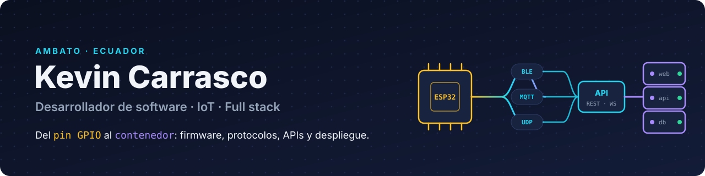
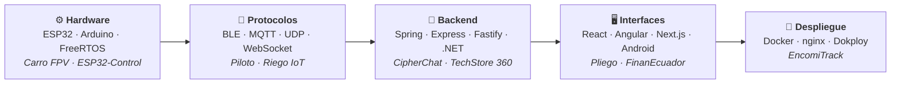

<picture>
  <source media="(prefers-color-scheme: dark)" srcset="assets/banner-dark.svg" />
  <source media="(prefers-color-scheme: light)" srcset="assets/banner-light.svg" />
  
</picture>

  
  
  

## Hola, soy Kevin

Construyo sistemas **de punta a punta**: desde el firmware que lee un sensor en un ESP32 hasta la plataforma web
que muestra esos datos, desplegada con Docker. Me gusta que lo que hago se pueda **levantar con un solo comando,
probar y entender**: cada proyecto trae su `docker compose`, sus diagramas y sus pruebas.

- 🔌 **IoT y embebidos** — firmware en C++ para ESP32 y Arduino, FreeRTOS, Bluetooth LE, MQTT, UDP y portales cautivos.
- 🧩 **Full stack** — APIs con Spring Boot, Express, Fastify y ASP.NET Core; interfaces con React, Angular y Next.js.
- 🔐 **Seguridad y datos** — cifrado en capas, JWT, PostgreSQL, MongoDB, SQL Server y despliegue con Docker, nginx y Traefik.

## Del pin GPIO al contenedor

Así se conectan las capas en las que trabajo, con un proyecto real en cada una:

## Proyectos

<!-- PROYECTOS:INICIO -->
<table>
<tr><td width="50%" valign="top"> <b><a href="https://github.com/Jostero32/Piloto">Piloto</a></b> Librería Arduino, protocolo y app Android para controlar robots por Bluetooth: el robot declara sus sensores, salidas y conductas al conectarse, y la app arma su interfaz a partir de esa descripción. <code>Android</code> <code>Java</code> <code>Arduino</code> <code>C++</code> <code>ESP32</code> <code>Bluetooth LE</code> Software verificado; ensayo físico en curso · 2026</td><td width="50%" valign="top"> <b><a href="https://github.com/Jostero32/ProyectoSeguridad">CipherChat</a></b> Mensajería en tiempo real al estilo WhatsApp con cifrado simétrico configurable en tres capas: datos en reposo, API REST y WebSocket (AES-GCM, DES-CBC, ChaCha20). <code>Angular</code> <code>Spring Boot</code> <code>Java 21</code> <code>PostgreSQL</code> <code>MinIO</code> <code>WebSocket</code> Funcional · 2026</td></tr>
<tr><td width="50%" valign="top"> <b><a href="https://github.com/Jostero32/Proyecto-Latex-Web">Pliego · editor LaTeX colaborativo</a></b> Editor LaTeX web al estilo de Overleaf: proyectos con imágenes, compilación a PDF en contenedores aislados, colaboración en tiempo real con cursores y SyncTeX en ambos sentidos. <code>TypeScript</code> <code>React</code> <code>Vite</code> <code>Fastify</code> <code>Yjs</code> <code>Hocuspocus</code> En desarrollo activo · 2026</td><td width="50%" valign="top"> <b><a href="https://github.com/Jostero32/EncomiTrack">EncomiTrack</a></b> Proyecto integrador de un emprendimiento de encomiendas: portal del semestre, roles de pago con parámetros legales por vigencia y paz y salvo con liquidación laboral, desplegados juntos con un solo docker compose. <code>Next.js</code> <code>Angular</code> <code>Express</code> <code>TypeORM</code> <code>SQLite</code> <code>Docker</code> Desplegado · 2026</td></tr>
<tr><td width="50%" valign="top"> <b><a href="https://github.com/Jostero32/economia-amortizacion">FinanEcuador</a></b> Simulador financiero para Ecuador: créditos con amortización francesa y alemana, inversiones a plazo fijo y ahorro programado con tasas del BCE, solicitudes con flujo de asesor y verificación de identidad (eKYC) con lectura de MRZ y comparación facial. <code>React</code> <code>Vite</code> <code>Tailwind</code> <code>Express</code> <code>Sequelize</code> <code>PostgreSQL</code> Desplegado (proyecto académico) · 2026</td><td width="50%" valign="top"> <b><a href="https://github.com/Jostero32/Carro-Fpv-Wifi-Esp32">Carro FPV Wi-Fi con ESP32</a></b> Carro RC en primera persona controlado desde la PC con volante o control: comandos UDP a 50 Hz con failsafe, video MJPEG desde una ESP32-CAM y app de escritorio con telemetría y calibración. <code>ESP32</code> <code>ESP32-CAM</code> <code>C++</code> <code>Arduino</code> <code>Python</code> <code>pywebview</code> Funcional · 2026</td></tr>
<tr><td width="50%" valign="top"> <b><a href="https://github.com/Jostero32/Sistema-Riego-IoT">Sistema de riego IoT</a></b> Monitoreo de un sistema de riego: Arduino Mega que envía tramas por serie, gateway ESP32 que publica por MQTT, y backend Spring Boot con MongoDB, API REST y WebSocket en tiempo real. <code>ESP32</code> <code>Arduino</code> <code>MQTT</code> <code>Mosquitto</code> <code>Spring Boot</code> <code>MongoDB</code> Backend probado de extremo a extremo; firmware compila · 2026</td><td width="50%" valign="top"> <b><a href="https://github.com/Jostero32/ESP32-Control">ESP32-Control</a></b> Firmware para ESP32 con cuatro botones que envían peticiones HTTP(S) a una API configurable, con portal cautivo para el Wi-Fi y panel de administración protegido, todo embebido en un único binario. <code>ESP32</code> <code>C++</code> <code>Arduino</code> <code>FreeRTOS</code> <code>HTML/JS</code> Compila sin advertencias; pendiente de prueba en placa · 2026</td></tr>
</table>

<b>Más proyectos (3)</b>

 

<table>
<tr><td width="50%" valign="top"><b><a href="https://github.com/Jostero32/TechStore360">TechStore 360</a></b> API REST desplegada en dos instancias detrás de un balanceador nginx con alta disponibilidad (keepalived), conmutación de base de datos, autenticación con Firebase y facturación por SOAP. <code>Python</code> <code>Flask</code> <code>nginx</code> <code>Keepalived</code> <code>PostgreSQL</code> <code>Firebase</code> Desplegado (proyecto académico) · 2026</td><td width="50%" valign="top"> <b><a href="https://github.com/Jostero32/RestauranteDomotico">Restaurante domótico</a></b> Maqueta de restaurante automatizado: Arduino Mega con mesas, puerta, garaje y sensores, y un ESP32 que crea la red del local con pedidos en tiempo real por WebSocket. <code>Arduino Mega</code> <code>ESP32</code> <code>C++</code> <code>WebSocket</code> <code>JSON</code> <code>MyOpenLab</code> Prototipo funcional (maqueta) · 2025</td></tr>
<tr><td width="50%" valign="top"> <b><a href="https://github.com/Jostero32/Guitarra_CloneHero_Inalambrico_esp32">Guitarra inalámbrica para Clone Hero</a></b> Control de guitarra para Clone Hero con ESP32 que se anuncia por Bluetooth LE como gamepad estándar de 9 botones, sin drivers. <code>ESP32</code> <code>C++</code> <code>Arduino</code> <code>Bluetooth LE</code> <code>HID</code> Funcional; correcciones de 2026 pendientes de probar en placa · 2024</td><td width="50%"></td></tr>
</table>

Sección generada automáticamente a partir del <code>portfolio.json</code> de cada repositorio · 11 proyectos.
<!-- PROYECTOS:FIN -->

## Tecnologías

| Área | Herramientas |
|---|---|
| **Embebidos** |  &nbsp;     |
| **Lenguajes** |  |
| **Backend** |  &nbsp;   |
| **Frontend y móvil** |  |
| **Datos** |  &nbsp;   |
| **DevOps** |  &nbsp;   |

## Cómo trabajo

- **Todo levanta con Docker.** Cada servicio se encuentra por el nombre de su contenedor y las credenciales viven en
  un `.env` que no se versiona; el repositorio solo trae `.env.example`.
- **Documentación que se ve.** Diagramas de arquitectura en Mermaid, esquemas de conexiones en SVG y capturas
  generadas automáticamente desde la aplicación real.
- **Pruebas antes de publicar.** Por ejemplo, Piloto suma 176 pruebas de la app y 350 comprobaciones del protocolo;
  el firmware de los proyectos ESP32 compila sin advertencias.

🤖 Este perfil se actualiza solo: una <a href=".github/workflows/proyectos.yml">GitHub Action</a> lee el
<code>portfolio.json</code> de cada repositorio con la etiqueta <code>portfolio</code> y regenera la sección de
proyectos todos los días.
