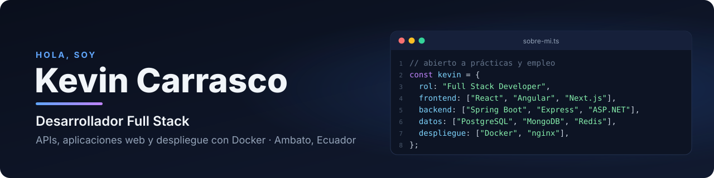
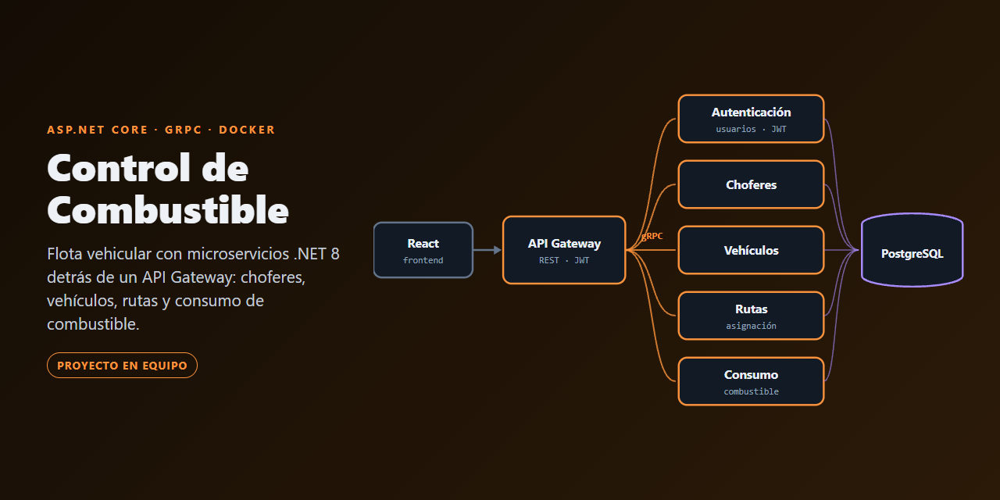
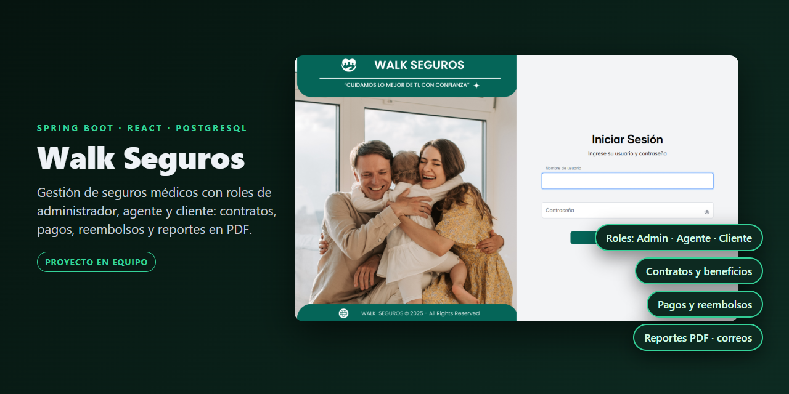
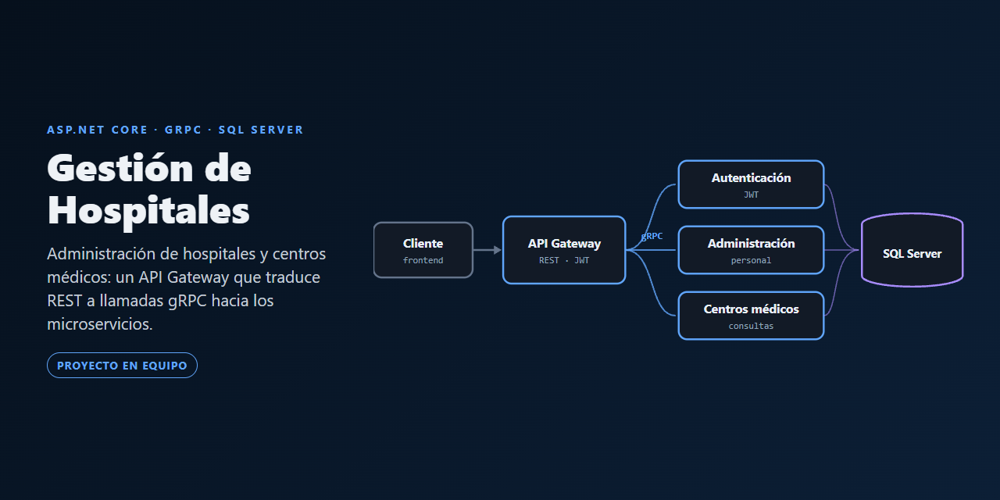

<picture>
  <source media="(prefers-color-scheme: dark)" srcset="assets/cabecera-dark.svg" />
  <source media="(prefers-color-scheme: light)" srcset="assets/cabecera-light.svg" />
  
</picture>

  

  
  
  
  

---

## 👨‍💻 Sobre mí

Soy **desarrollador full stack**. Construyo aplicaciones completas: la API, la base de datos, la interfaz y el
despliegue. Me gusta que cada proyecto se pueda **levantar con un solo `docker compose up`**, que esté
documentado con diagramas y capturas, y que tenga pruebas.

- 🧩 **Backend:** APIs REST con **Spring Boot**, **Express**, **Fastify**, **ASP.NET Core** y **Flask**; autenticación con JWT y tiempo real con WebSocket.
- 🖥️ **Frontend:** **React**, **Angular** y **Next.js** con TypeScript, Vite y Tailwind.
- 🗄️ **Datos:** **PostgreSQL**, **MongoDB**, **SQL Server** y **Redis**, con TypeORM, Sequelize, Drizzle y Entity Framework.
- 🐳 **Despliegue:** **Docker Compose**, nginx como gateway y Dokploy; configuración por `.env` y servicios por nombre de contenedor.
- 🔐 **Seguridad:** cifrado en capas (AES-GCM, ChaCha20), JWT y manejo de secretos fuera del repositorio.
- 🔌 **Además:** firmware para **ESP32 y Arduino**, con apps y backends que se conectan a ellos.
- 🎯 Busco **prácticas** o un puesto de **desarrollador junior / full stack**.

---

## 🛠️ Tecnologías

<table align="center">
  <tr>
    <td align="right"><b>Lenguajes</b></td>
    <td></td>
  </tr>
  <tr>
    <td align="right"><b>Frontend</b></td>
    <td></td>
  </tr>
  <tr>
    <td align="right"><b>Backend</b></td>
    <td></td>
  </tr>
  <tr>
    <td align="right"><b>Bases de datos</b></td>
    <td></td>
  </tr>
  <tr>
    <td align="right"><b>DevOps y herramientas</b></td>
    <td></td>
  </tr>
  <tr>
    <td align="right"><b>Móvil e IoT</b></td>
    <td></td>
  </tr>
</table>

  
  
  
  
  
  
  
  
  
  
  
  
  

---

## 🚀 Proyectos destacados

<!-- PROYECTOS:INICIO -->
<table>
<tr>
<td width="50%" valign="top">

<h3><a href="https://github.com/Jostero32/Proyecto-Latex-Web">Pliego · editor LaTeX colaborativo</a></h3>

Editor LaTeX web al estilo de Overleaf: proyectos con imágenes, compilación a PDF en contenedores aislados, colaboración en tiempo real con cursores y SyncTeX en ambos sentidos.

      

En desarrollo activo · 2026

</td>
<td width="50%" valign="top">

<h3><a href="https://github.com/Jostero32/ProyectoSeguridad">CipherChat</a></h3>

Mensajería en tiempo real al estilo WhatsApp con cifrado simétrico configurable en tres capas: datos en reposo, API REST y WebSocket (AES-GCM, DES-CBC, ChaCha20).

      

Funcional · 2026

</td>
</tr>
<tr>
<td width="50%" valign="top">

<h3><a href="https://github.com/Jostero32/Proyecto-Web-y-Moviles---Backend">Shop&amp;Buy · marketplace</a></h3>

Marketplace de compra y venta de segunda mano: productos con fotos y ubicación, chat entre comprador y vendedor en tiempo real, favoritos, calificaciones y cuentas verificadas por correo.

      

Funcional (proyecto académico) · 2025

</td>
<td width="50%" valign="top">

<h3><a href="https://github.com/Jostero32/EncomiTrack">EncomiTrack</a></h3>

Proyecto integrador de un emprendimiento de encomiendas: portal del semestre, roles de pago con parámetros legales por vigencia y paz y salvo con liquidación laboral, desplegados juntos con un solo docker compose.

      

Desplegado · 2026

</td>
</tr>
</table>

<b>Más proyectos (2)</b>

 

<table>
<tr>
<td width="50%" valign="top">

<h3><a href="https://github.com/Jostero32/economia-amortizacion">FinanEcuador</a></h3>

Simulador financiero para Ecuador: créditos con amortización francesa y alemana, inversiones a plazo fijo y ahorro programado con tasas del BCE, solicitudes con flujo de asesor y verificación de identidad (eKYC) con lectura de MRZ y comparación facial.

      

Desplegado (proyecto académico) · 2026

</td>
<td width="50%" valign="top">

<h3><a href="https://github.com/Jostero32/TechStore360">TechStore 360</a></h3>

API REST desplegada en dos instancias detrás de un balanceador nginx con alta disponibilidad (keepalived), conmutación de base de datos, autenticación con Firebase y facturación por SOAP.

      

Desplegado (proyecto académico) · 2026

</td>
</tr>
</table>

<!-- PROYECTOS:FIN -->

---

## 🤝 Proyectos en equipo

Proyectos de la carrera desarrollados con compañeros, en los que trabajé principalmente en el backend.

<!-- EQUIPO:INICIO -->
<table>
<tr>
<td width="33%" valign="top">

<h3><a href="https://github.com/W1llAn/ControlCombustibleBackend/tree/develop">Control de Combustible</a></h3>

Gestión de flota vehicular con microservicios .NET 8 detrás de un API Gateway: choferes, vehículos, asignación de rutas y consumo de combustible.

<b>Mi aporte:</b> API Gateway, autenticación con JWT y los microservicios de choferes y consumo de combustible: 8 de los 14 PR aceptados.

     

<a href="https://github.com/W1llAn/ControlCombustibleBackend/tree/develop">Backend</a> · <a href="https://github.com/W1llAn/ControlCombustibleFrontend">Frontend</a>

</td>
<td width="33%" valign="top">

<h3><a href="https://github.com/IsmaelSailema20/GestionSegurosBackend">Walk Seguros</a></h3>

Gestión de seguros médicos con roles de administrador, agente y cliente: contratos, beneficios, pagos, reembolsos y reportes en PDF.

<b>Mi aporte:</b> Login y usuarios, contratos, beneficios y reportes en el backend, pruebas unitarias en el frontend y correcciones para SonarQube: 13 PR aceptados.

     

<a href="https://github.com/IsmaelSailema20/GestionSegurosBackend">Backend</a> · <a href="https://github.com/IsmaelSailema20/GestionSegurosFrontend">Frontend</a> · <a href="https://gestion-seguros-frontend.vercel.app">Demo</a>

</td>
<td width="33%" valign="top">

<h3><a href="https://github.com/W1llAn/GestionHospitalesBackend">Gestión de Hospitales</a></h3>

Administración de hospitales y centros médicos con un API Gateway que traduce REST a llamadas gRPC hacia los microservicios.

<b>Mi aporte:</b> Microservicios de autenticación y administración, y la comunicación gRPC con JWT: 4 de los 7 PR aceptados.

   

<a href="https://github.com/W1llAn/GestionHospitalesBackend">Backend</a>

</td>
</tr>
</table>
<!-- EQUIPO:FIN -->

---

## 🔌 IoT y hardware

También desarrollo firmware para ESP32 y Arduino, con las apps y backends que se conectan a él.

<!-- IOT:INICIO -->
<table>
<tr>
<td width="33%" valign="top">

<b><a href="https://github.com/Jostero32/ESP32-Control">ESP32-Control</a></b> 
Firmware para ESP32 con cuatro botones que envían peticiones HTTP(S) a una API configurable, con portal cautivo para el… 
  
</td>
<td width="33%" valign="top">

<b><a href="https://github.com/Jostero32/Sistema-Riego-IoT">Sistema de riego IoT</a></b> 
Monitoreo de un sistema de riego. 
  
</td>
<td width="33%" valign="top">

<b><a href="https://github.com/Jostero32/Piloto">Piloto</a></b> 
Librería Arduino, protocolo y app Android para controlar robots por Bluetooth. 
  
</td>
</tr>
<tr>
<td width="33%" valign="top">

<b><a href="https://github.com/Jostero32/Carro-Fpv-Wifi-Esp32">Carro FPV Wi-Fi con ESP32</a></b> 
Carro RC en primera persona controlado desde la PC con volante o control. 
  
</td>
<td width="33%" valign="top">

<b><a href="https://github.com/Jostero32/RestauranteDomotico">Restaurante domótico</a></b> 
Maqueta de restaurante automatizado. 
  
</td>
<td width="33%" valign="top">

<b><a href="https://github.com/Jostero32/Guitarra_CloneHero_Inalambrico_esp32">Guitarra inalámbrica para Clone Hero</a></b> 
Control de guitarra para Clone Hero con ESP32 que se anuncia por Bluetooth LE como gamepad estándar de 9 botones, sin… 
  
</td>
</tr>
</table>
<!-- IOT:FIN -->

---

  ¿Tienes un proyecto o una vacante? Escríbeme a <a href="mailto:carrascokevin756@gmail.com">carrascokevin756@gmail.com</a> o por <a href="https://www.linkedin.com/in/kevin-carrasco-360b8b451">LinkedIn</a>.

